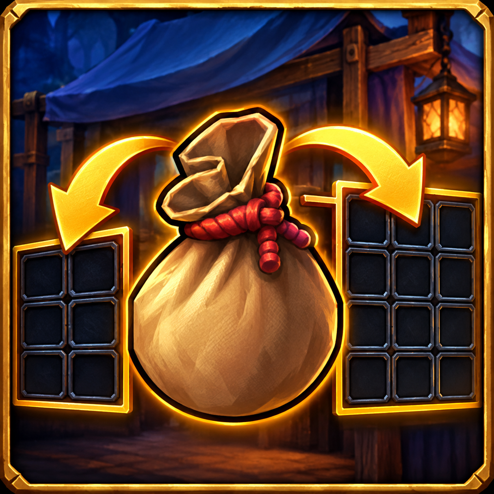

  

<h1 align="center">Vendor Expand (Forever)</h1>

  <strong>See up to 50 merchant items per page in one click.</strong> 
  <em>Jusqu'à 50 objets du marchand par page, en un clic.</em>

  <a href="#english">English</a> · <a href="#français">Français</a>

## English

Vendor Expand adds a small arrow to the merchant window. Click it and the window grows to show many more items per page, so you scroll through fewer pages. Click again to get the normal window back. The original Blizzard look stays the same.

### Features

- **One-click expand:** an arrow on the merchant window switches between the normal and the large view.
- **Pick the page size:** 10, 20, 30, 40 or 50 items per page from the "Items" menu.
- **Remembered:** your choice is saved and applied every time you open a merchant.
- **Original look:** the item slots, buyback tab and buttons are Blizzard's own, only rearranged.
- **English and French:** the addon follows your game language.

### Installation

Copy the `Vendor_Expand_Forever` folder into `Interface\AddOns`, then restart the game or reload your interface.

### Commands

| Command | What it does |
|---|---|
| `/vef` | Switch between the normal and the large window |
| `/vef 10` … `/vef 50` | Show 10, 20, 30, 40 or 50 items per page |

### Copyright

Copyright (c) 2026 Daeler. All rights reserved.

---

## Français

Vendor Expand ajoute une petite flèche à la fenêtre du marchand. Un clic et la fenêtre s'agrandit pour afficher beaucoup plus d'objets par page : moins de pages à faire défiler. Un autre clic et la fenêtre revient à la normale. L'apparence d'origine de Blizzard est conservée.

### Fonctionnalités

- **Agrandir en un clic :** une flèche sur la fenêtre du marchand passe de la vue normale à la grande vue.
- **Choix du nombre d'objets :** 10, 20, 30, 40 ou 50 objets par page depuis le menu « Objets ».
- **Mémorisé :** votre choix est enregistré et réappliqué à chaque marchand.
- **Apparence d'origine :** les cases d'objets, l'onglet de rachat et les boutons sont ceux de Blizzard, simplement réorganisés.
- **Français et anglais :** l'addon suit la langue de votre jeu.

### Installation

Copiez le dossier `Vendor_Expand_Forever` dans `Interface\AddOns`, puis relancez le jeu ou rechargez l'interface.

### Commandes

| Commande | Effet |
|---|---|
| `/vef` | Passer de la fenêtre normale à la grande fenêtre |
| `/vef 10` … `/vef 50` | Afficher 10, 20, 30, 40 ou 50 objets par page |

### Droits d'auteur

Copyright (c) 2026 Daeler. Tous droits réservés.
